# 智录 · GyanisScribe

<p align="center">
  
</p>

<p align="center">
  <b>截图 · 标注 · 贴图 · 取色 · 录屏 · 文字识别</b><br>
  Windows 优先的桌面效率工具，常驻托盘、热键直达；界面、图标与代码全部原创。
</p>

<p align="center">
  
  
  
  
  
</p>

<p align="center">
  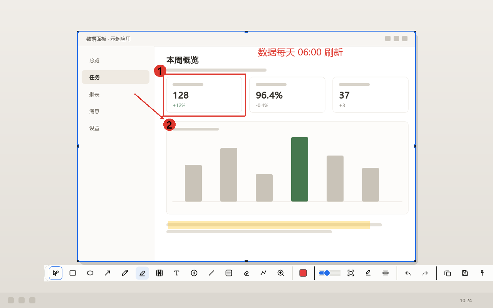
</p>

## 功能特性

| 能力 | 一句话 |
| --- | --- |
| **截图** | 全屏 / 框选 / 窗口 / 多屏 / 高 DPI，悬停认窗口与界面元素，放大镜与像素读数随行，滚动长截图 |
| **标注** | 十四件工具：矩形、椭圆、箭头、画笔、高亮、马赛克、高斯模糊、文字、序号、橡皮擦、折线、放大镜等 |
| **贴图** | 把图钉在屏幕最上层对着用：缩放旋转、分组、吸附对齐、多选、动图续播、拖文件与链接上屏 |
| **取色** | 冻帧加放大镜，六种写法轮换，最近取色一排随时取回 |
| **录屏** | 整屏 / 选区 / 窗口，MP4 与 GIF，编码器真探测，麦克风与系统声可混音 |
| **识别** | 系统 OCR 与 Tesseract 双后端，二维码 / 条形码识别，结果可导出 |

每个功能的完整行为与每一格设置的含义见 [使用指南](docs/UserGuide.md)。

### 截图：框到哪，读到哪

按下热键整屏冻帧，拖框时选区里浮出三分网格，放大镜跟着光标报坐标与颜色；
悬停能认出光标压着的窗口甚至按钮一级的界面元素，原地按一下即选中。
尺寸要精确有键盘路：`S` 敲「宽x高」、`A` 锁长宽比。

<p align="center">
  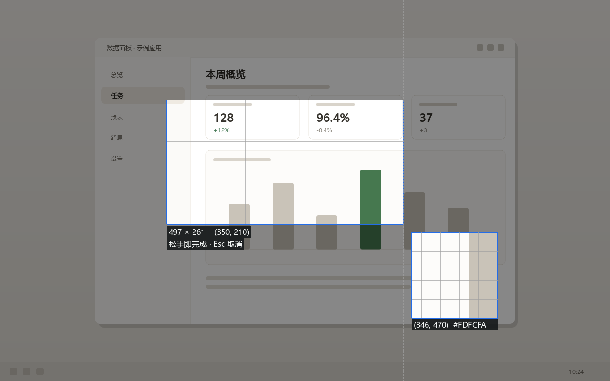
</p>

### 贴图：钉在屏幕上对着用

截下来的、剪贴板里的、盘上的文件、网页图片地址，都能贴成一张置顶的图；
滚轮缩放、`Ctrl`+滚轮旋转、`Shift`+滚轮调透明度，拖到屏边自动收起，按住 `Shift` 拖动与别的窗口对齐。
贴图上还能直接标注、裁剪、取色与识别。

<p align="center">
  
</p>

### 标注：画完即成品

色板、线宽、字号、填充、线型、箭头款式逐档可调，色板还能换成自己的一套并导出分享；
选中即拖、多选整组改，撤销重做一路到底；`F5` 就地重抓这一块屏幕，画好的标注原地留着。

### 录屏与识别

录屏走 `ffmpeg` 子进程（随包分发、不链接），停止后后台编码不冻界面；
识别优先用系统自带的 `Windows.Media.Ocr`，语言包随安装包带，不需要自己放文件。

## 界面一览

主窗口十个设置页的真实渲染（离屏抓取控件自绘画面，不是设计稿），出图工具与重拍办法见 [开发指南](docs/Development.md)。

<p>
  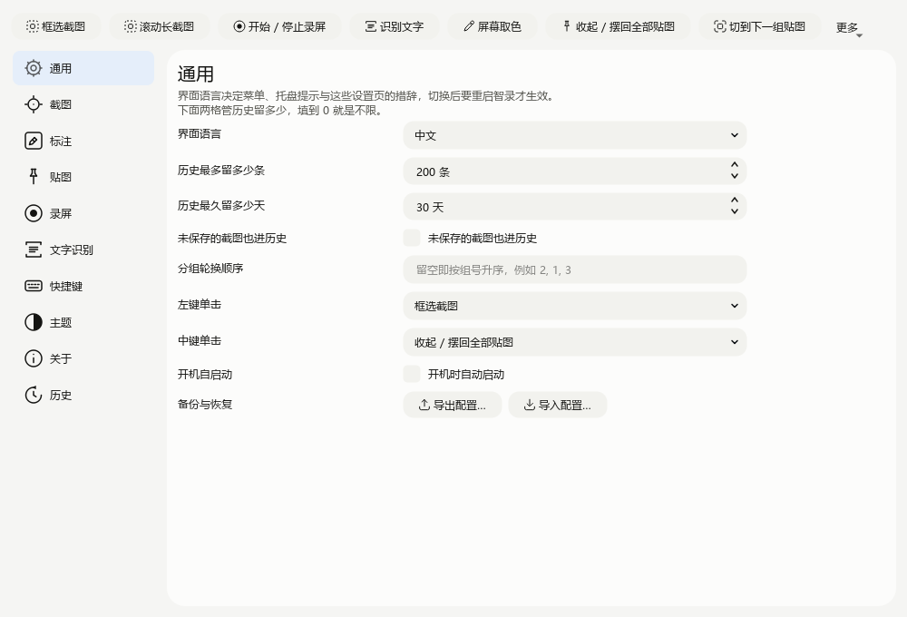
  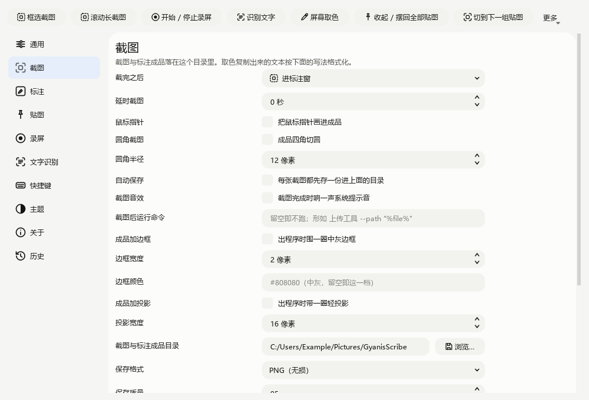
  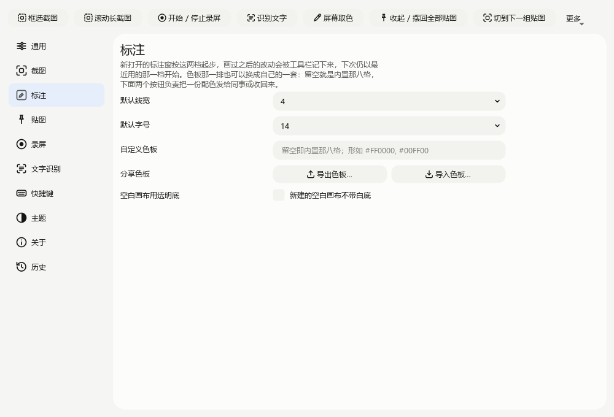
  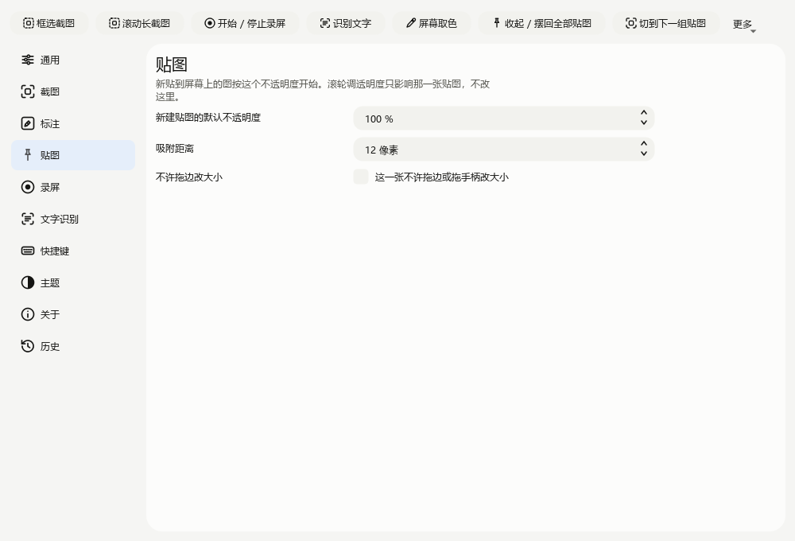
  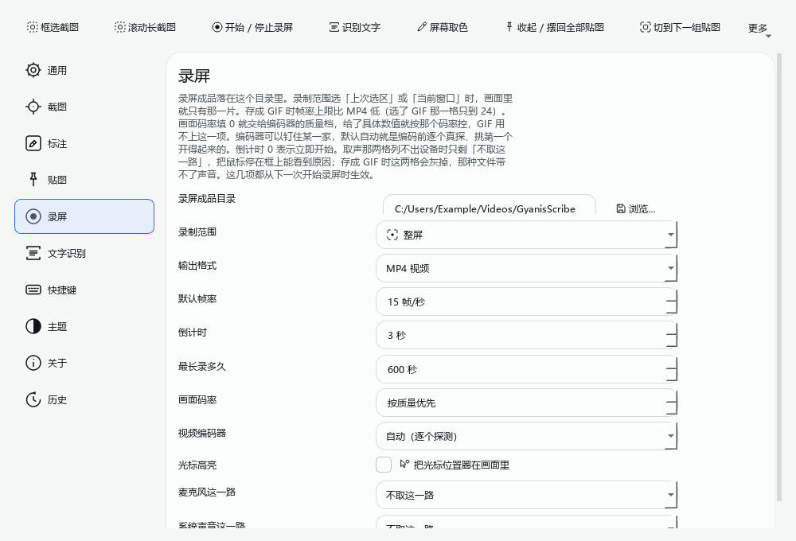
  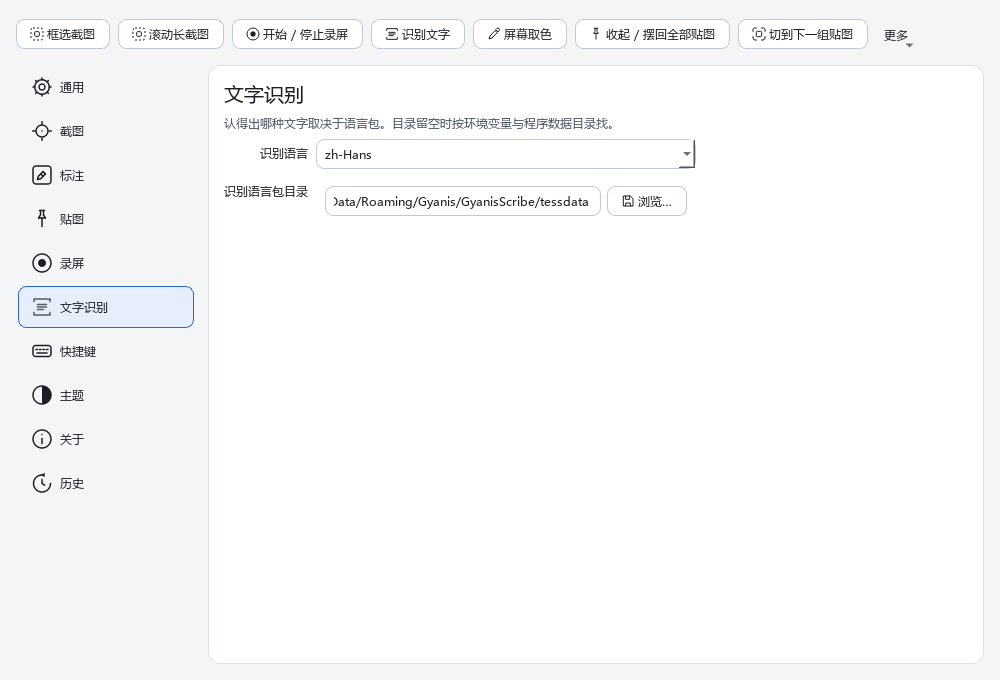
  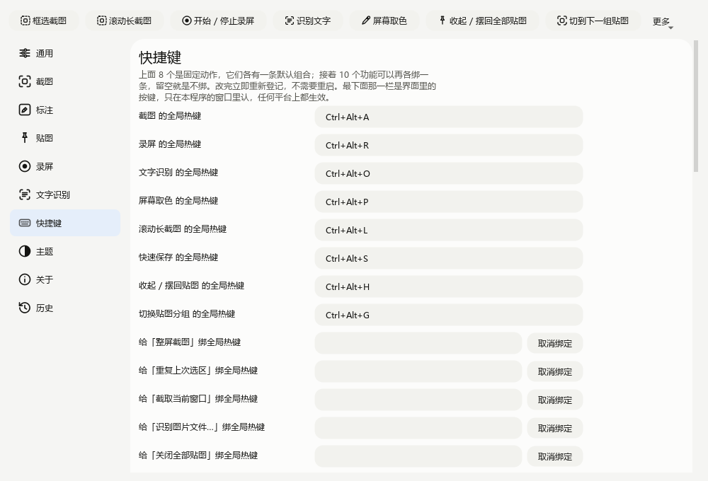
  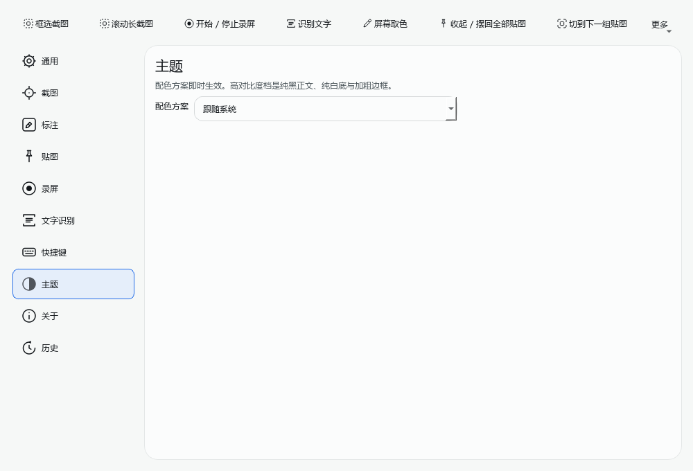
  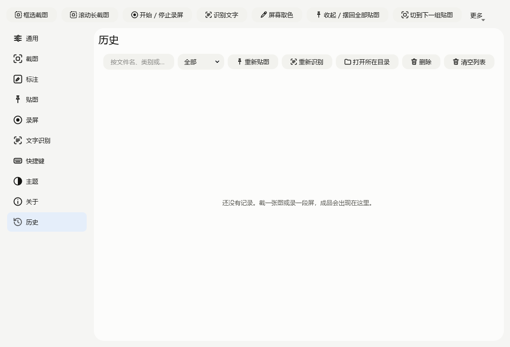
  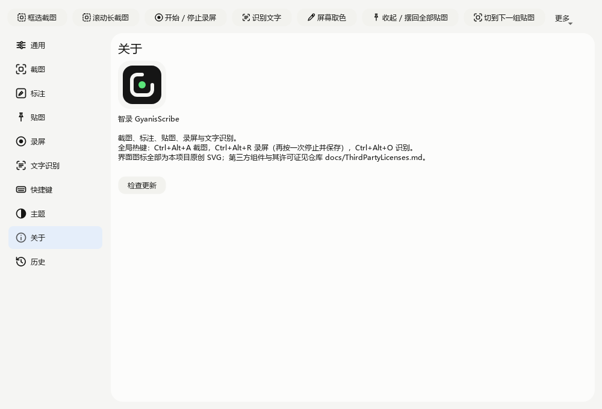
</p>

浅色、深色、高对比度三套主题加跟随系统；高 DPI 与多屏；中英双语界面。

## 下载安装

- **安装器 / 绿色包**：到 [Releases](https://github.com/Gyanis9/GyanisScribe/releases) 取 NSIS 安装器或 zip 绿色目录，装完即用——`ffmpeg` 与识别语言包随包带，不需要另装任何东西。
- **便携模式**：程序目录旁放一个空的 `portable.txt`，配置改读写同目录下的 `GyanisScribe.ini`。
- **自构建**：见下面[从源码构建](#从源码构建)。

## 快速开始

```powershell
GyanisScribe.exe            # 起托盘，按 Ctrl+Alt+A 截第一张图
GyanisScribe.exe --help     # 启动参数
GyanisScribe.exe --selftest # 把启动路径跑完就退，退出码 0 即自检通过
```

程序常驻托盘，主窗口随时从托盘菜单打开；全局热键撞了可在设置里改，改完立刻生效。

### 全局热键

| 动作 | 默认组合 |
| --- | --- |
| 框选截图 | `Ctrl+Alt+A` |
| 录屏 / 停止并保存 | `Ctrl+Alt+R` |
| 文字识别 | `Ctrl+Alt+O` |
| 屏幕取色 | `Ctrl+Alt+P` |
| 滚动长截图 | `Ctrl+Alt+L` |
| 快速保存 | `Ctrl+Alt+S` |
| 收起 / 摆回全部贴图 | `Ctrl+Alt+H` |
| 切换贴图分组 | `Ctrl+Alt+G` |

八个固定热键之外还能给任意功能再绑十个；截图遮罩、标注窗与贴图窗的窗内键见 [使用指南 · 键位表](docs/UserGuide.md#键位表)。

## 性能亮点

Release 档本机实测（2560×1440 单屏），读数用例只报数不断言，方法与全表见 [开发指南 · 性能实测](docs/Development.md#性能实测)：

| 指标 | 实测 |
| --- | --- |
| 抓一帧（DXGI 桌面重复） | 中位 **6.0ms** |
| 整条框选链（铺遮罩 → 拖框 → 交付） | 中位 **8.5–10.9ms** |
| 冷启动到自检就绪 | 中位 **391ms** |
| 4K 图识别一次 | 中位 **428ms** |
| 标注窗整幅重绘（30 个图形） | 中位 **3.7ms** |

## 从源码构建

```bat
set QTDIR=G:\Tools\Qt\6.11.1\msvc2022_64
scripts\WindowsBuild.bat release
```

一条命令包含配置、编译与 `ctest`。前置组件表、打包脚本与门禁口径见 [开发指南](docs/Development.md)。

## 项目结构

```
src/Base        无业务公共底座：值类型、日志、目录 provider、文案与本地化设施
src/Core        领域实现：图像、设置、热键、取色、历史、贴图、截图、识别、录屏、标注
src/App         应用服务集：命令行、抓取意图与交付、托盘、剪贴板贴图、自定义热键、单实例、崩溃兜底、更新检查
src/Main        程序骨架：Application、AppController、MainWindow、Main 入口
src/Gui         界面层：设计令牌与主题、通用控件、图标与样式表，及各功能的窗口
src/Plugins     可换用后端：条码识别、抓帧来源、识别引擎、录屏编码
src/Platform    平台能力抽象（热键、窗口几何、自启、系统集成）
tests/          逐级镜像 src 的目录结构，统一 GoogleTest
```

## 文档索引

| 文档 | 内容 |
| --- | --- |
| [docs/UserGuide.md](docs/UserGuide.md) | 各功能完整行为、设置项含义与窗内键位 |
| [docs/Development.md](docs/Development.md) | 构建、打包、质量门禁、性能实测与贡献规范 |
| [docs/Roadmap.md](docs/Roadmap.md) | 差距审计台账、后续计划与已知问题 |
| [docs/OcrBackends.md](docs/OcrBackends.md) | 两个识别后端的选型顺序与语言包查找路径 |
| [docs/ThirdPartyLicenses.md](docs/ThirdPartyLicenses.md) | 随包分发的组件、许可证与合规路线 |
| [docs/UiStyleGuide.md](docs/UiStyleGuide.md) | 设计令牌、窗口样式与深浅主题对照 |

## 参与贡献

1. 按 [从源码构建](#从源码构建) 跑一次门禁脚本，绿了才谈改动。
2. 改到 C++ 面先跑仓库根的 clang-format，再跑 `scripts\WindowsBuild.bat <preset>`。
3. 加功能要带用例：`tests/` 逐级镜像 `src/`，每条用例说明它钉住什么，并且改回缺陷行为会红。
4. 提交信息用约定式提交写中文「为什么」：`<类型>[(范围)]: <描述>`。

规范要点与静态门禁清单见 [开发指南 · 参与贡献](docs/Development.md#参与贡献)。

## 许可与第三方声明

本软件**免费供任何人使用**，条款见仓库根的 [`LICENSE.txt`](LICENSE.txt)。
代码、界面与图标均为原创；第三方组件（Qt、FFmpeg、Tesseract、spdlog、zxing-cpp 等）的许可证与分发方式逐条列在
[docs/ThirdPartyLicenses.md](docs/ThirdPartyLicenses.md)，许可证正文随包发在 `licenses/` 下。
